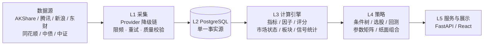

<div align="center">

# A-Share Quant Terminal

**A 股行情采集 · 因子评分 · 条件选股 · 回测验证 · 仓位罗盘 · 机器人播报**

把「数据 → 指标 → 信号 → 验证」做成一条可复现的本地闭环。

[](https://github.com/hui-Elna/a-share-quant-terminal/actions/workflows/ci.yml)
[](https://www.python.org/)
[](https://fastapi.tiangolo.com/)
[](https://www.postgresql.org/)
[](https://react.dev/)
[](LICENSE)

[在线演示](https://hui-Elna.github.io/a-share-quant-terminal/) · [快速开始](#快速开始) · [核心能力](#核心能力) · [架构](#架构) · [当前策略](#当前策略) · [机器人推送](#机器人推送) · [界面一览](#界面一览) · [文档](#文档)

</div>

---


<p align="center"><sub>盘后分析：市场状态、持仓配置建议、一周市场温度计与数据新鲜度</sub></p>

---

## 这是什么

一套面向个人研究的 **A 股量化终端**。它不预测涨跌，而是把投资决策所需的数据与信号整理成一套 **可复现、可归因、可证伪** 的系统：

- **数据本地化**：行情、估值、资金流、板块、指数、两融、国债收益率、新闻全部落到本地 PostgreSQL；
- **计算本地化**：指标、六维因子、市场温度、市场状态、板块评分都在本地库完成，接口请求不访问外部数据源；
- **结果可复现**：每次选股都带 `run_id`、参数快照与数据版本，改参数必然产生新 run；
- **验证闭环**：同一套成交规则支持回测、参数敏感性矩阵与纸面组合跟踪；
- **决策约束**：仓位罗盘按风险预算输出“做不做、做多大、何时撤”，用情景卡与空仓建议约束行为，不承诺收益；
- **结论到手**：每个交易日选股完成后，企业微信机器人自动把各策略 TOP N 推到群里，不用守着页面；
- **诚实表达**：缺失数据保留 `NULL`，不补 0；数据新鲜度由前端徽标显式标注。

> 回测 ≠ 实盘。系统价值在于让决策过程可追溯，而不是承诺收益。

---

## 核心能力

| 能力 | 说明 |
|---|---|
| **采集与治理** | Provider 降级链 `akshare → baostock`，腾讯/新浪/东财/同花顺/中债/中证专项通道；限频、重试、熔断、幂等 upsert、断点续传 |
| **单一事实源** | PostgreSQL 16；个股日线按年 RANGE 分区；板块成分用 SCD2 表达；财报/分红按公告日做 point-in-time |
| **指标与因子** | MA / RSI(Wilder) / MACD / BOLL / ATR / KDJ / 动量 / 波动 / 量比；价值、质量、动量、波动、流动性、情绪六维因子 |
| **条件选股** | AND/OR 条件树，支持比较、区间、集合、排名分位、行业约束；参数进入计算、缓存键与 run 快照 |
| **回测与验证** | T+1 开盘成交、佣金/印花税/滑点、涨跌停/停牌不可成交、后复权收益；参数矩阵与纸面组合复用同一引擎 |
| **市场与板块** | 市场温度计（7 子项）、五态市场状态与配置建议、板块三面评分、风格轮动、6 宽基牛熊估值 |
| **仓位罗盘（V9）** | 风险预算与决策约束：板块预算上限、空仓建议、六张情景卡、T+1 开盘校验、纸面组合复盘、成分股广度、ETF 映射；不承诺收益 |
| **服务与展示** | FastAPI + React；统一错误码、数据新鲜度徽标、任务监控、CSV 导出 |
| **机器人推送** | 选股任务完成后自动推送当日各策略 TOP N 到企业微信群机器人；幂等去重、失败重试、dry-run 预览 |

---

## 架构



**分层规则**

```
api/ ──────────────► strategy/ ──► engine/ ──► db/
 │                        │           │
 │                        └───────────┴──────► core/
 └──► pipeline.py ──► ingest/ ──► db/
```

- `ingest/` 只依赖 `core` + `db`，不 import `api` / `strategy`；
- `engine/` 不联网（板块资金流降级除外），不 import `ingest`；
- `strategy/` 只读数据库，不访问外部数据源；
- `api/` 只做参数校验、读库与响应组装，不做计算；
- 定时任务、手动 API、CLI 都走 `pipeline.run_task`，保证“命令行能跑的，接口也能跑”。

---

## 当前策略

统一前置过滤：剔除 ST、停牌/退市、上市不足 60 个交易日、当日无行情。

| 策略 | 状态 | 选股逻辑 | 排序 |
|---|---|---|---|
| **A3** 央企 × 综合评分 | 正式启用 | `ownership='央企'`，六因子综合分 ≥ `min_score`（默认 6.0/10） | 综合分降序 |
| **A4** 高股息质量 × 低估值 | 正式启用 | `pe_min < PE_TTM < pe_max`（默认 3–15）、股息率 4.5%–15%、PB ≤ 2.5、综合分 ≥ 6.5、20 日均额 ≥ 5000 万、`close ≥ MA120 × 0.9`；仅在防御型市场阶段启用 | 股息率降序 |
| **C1** 海龟突破 | 正式启用（建议 40 日调仓） | 20 日新高 + 60 日动量 ≥ 0 + 20 日收益日标准差 ≤ 5% + 前 20 日涨幅 ≤ 25% + 非当日涨停 + 成交额 ≥ 1 亿；市场温度 < 70 且非避险下跌才开仓；回测/纸面 8% 止损 | 流通市值降序 |
| **C2** 高窄旗形 | 正式启用 | 40 日区间比 > 1.6、10 日收敛 < 1.12、缩量 < 0.5 倍、20 日均额 ≥ 1 亿 | 40 日区间比降序 |
| **C3** RPS 突破 | 正式启用（双均线 + 确认闸门） | RPS ≥ 90、接近 120 日新高 0.85、20 日涨幅 ≤ 8%、20 日波动 ≤ 5%；沪深300 `close ≥ MA20×0.995` 且 `≥ MA60`，并连续 2 日站稳、MA20 较 5 日前抬升才开仓；回测/纸面 8% 止损 | RPS 降序 |
| **C6** 布林挤压突破 | 正式启用 | 带宽 60 日低分位 + 突破上轨新高 + 放量 + 沪深300 趋势门槛 | 带宽分位升序 |

> 2026-11-28 起 C1/C2/C3/C6 由观察候选转为**正式启用**，进入每日选股、信号前瞻统计、策略天梯、共识榜、纸面组合与回测；此前“未通过统一门槛”的回测记录保留在历史报告中，仅作为风险提示。以代码中的 `SPECS` 为准（`CANDIDATE_SPECS` 当前为空）。A1/A2/B1–B5 已下线，其实现代码已在 V9 清理中删除，仅保留历史 run 记录；C4（涨停洗盘）、C5（均线放量突破）因回测无正向边际，已于 2026-11-22 永久移除（实现、测试、配置一并删除，仅保留历史 run）。

### 策略升级（2026-11）

本次升级依据 [因子优化报告](docs/FACTOR-OPTIMIZATION-2026-11.md)（区间 2024-01-02 ~ 2026-11-17，沪深300 基准 +17.43%，20 日调仓），只调整 A4/C1/C2/C3，A3/C6 未改动；C4/C5 已按该报告结论于 2026-11-22 永久移除。

| 策略 | 变更 | 改动前 → 改动后（生产口径） |
|---|---|---|
| A4 | 新增 `pe_min=3.0`；`div_min` 4.0→4.5；`min_score` 5.0→6.5 | +43.0% → **+47.3%**，胜率 57.0% → **59.5%** |
| C1 | 新增 `mom60_min=0`、`vol_cap=0.05`、当日涨停剔除 | 20 日 -32.8% → -17.6%；**40 日 +12.1%** |
| C2 | `tight_max` 1.15→1.12、`shrink_max` 0.6→0.5、`min_amount` 5000 万→1 亿 | -6.4% → **+11.2%**，回撤 -7.5% |
| C3 | 新增 `vol_cap=0.05`、`roc20_max=0.08`；`near_high_ratio` 0.9→0.85；新增沪深300 双均线闸门 | -60.6% → **+16.3%**，最差相位 -25.4% → -5.3% |

**使用注意**

- 升级后 `SIGNAL_SCHEMA_VERSION=5`：同参数的历史 `stg_run` 不再命中缓存，会自动按新逻辑重算；历史 run 仍可查询但不会被复用。
- C1 默认 20 日调仓仅用于横向对比，实际跟踪建议 40 日调仓（回测口径 `rebalance_days=40`）。
- C3 的双均线 + 连续站稳 + MA20 上行闸门会主动空仓；空仓是策略设计的一部分，不是数据缺失。
- C1 增加市场温度/避险状态闸门与 20 日涨幅上限；C1/C3 增加 `stop_loss_pct`（默认 8%），回测与纸面组合在**次日开盘**执行止损，卖出当日不回购。
- C1 纸面组合固定按 **40 日调仓**跟踪（20 日仅用于回测横向对比）；C1/C3 信号日成交拆成 T+1/T+2 各一半。
- C1/C3 持仓期增加状态风控：市场转入 `risk_off` 时次日开盘清仓；C3 在信号日温度 ≥70 时只开 50% 单笔仓位。
- 止损阈值对比（同区间）：C1 40 日 6%/7%/8% 分别为 -2.97%/-2.41%/-2.58%，C3 为 -2.20%/-2.25%/-2.25%，差异很小，默认保持 8%。
- 2026-06-01~2026-11-27 验证（沪深300 同期 -16.1%）：C1 40 日 **-2.6%**，C1 20 日 -6.6%；C3 **-2.3%**。单区间结果，不代表未来收益。
- C4/C5 已于 2026-11-22 永久移除，理由见 [C4/C5 因子诊断](docs/WASHOUT-FACTORS.md)（历史存档）。
- A4 的 `pe_min` 用于剔除周期股/一次性收益造成的「低 PE 陷阱」；提高 `min_score` 用于剔除高股息但质量差的标的。

---

## 机器人推送

每个交易日，系统在**盘后数据采集与入库校验完成后**自动生成仓位罗盘分析，再触发企业微信群机器人推送。整条链路串行执行，由后端定时任务与启动补跑共同触发，不依赖前端页面是否打开，也不要求进程恰好 16:30 在线。

**推送内容**

- 只取指定交易日（默认最近一次成功选股日）、非回测、`status=success` 的最新 run；
- 只推送当前启用策略（`SPECS`：A3 / A4 / C1 / C2 / C3 / C6，可用 `PUSH_ALGOS` 再收窄），每个策略默认前 `PUSH_TOP_N=10` 只；
- C1/C2/C3/C6 已并入正式启用集，推送不再带「观察·未通过回测」标注；`PUSH_OBSERVATION` / `OBSERVATION_ALGOS` 保留兼容，当前候选池为空；
- 每只股票后追加一句话归因（优先复述触发的条件，其次复述评分构成，缺失时标注「归因缺失」）；
- Markdown 消息超过 4 KB 自动截断，末尾附前端查看链接与「条件复述，非投资建议」提示。

示例：

```text
## GFNA 选股播报 | 2026-11-16

**央企 × 综合评分TOP（a3）**（2 只）
1. 中国建筑(601668) 评分 8.10 — PE_TTM（8.0 lt 15.0）；股息率（5.2 gt 3.0）
2. 中国石化(600028) 评分 7.90 — 综合评分 7.9

**高股息质量 × 低估值（a4）**（0 只）
无信号

查看：http://127.0.0.1:5173/algo-center

条件复述，非投资建议
```

**配置**（写入 `backend/.env`，模板见 [.env.example](backend/.env.example)）

| 变量 | 默认 | 说明 |
|---|---|---|
| `PUSH_ENABLED` | `0` | 总开关；配置 Webhook 后设为 `1` |
| `WECOM_WEBHOOK_URL` | 空 | 企业微信群机器人 Webhook；只存本地 `.env`，日志不输出完整地址 |
| `PUSH_ALGOS` | 空 | 推送策略，逗号分隔（如 `a3,a4`）；空=全部启用策略 |
| `PUSH_TOP_N` | `10` | 每个策略推送前 N 只 |
| `PUSH_MODE` | `always` | `always`=无信号也推送；`signals_only`=仅有信号时推送 |
| `PUSH_DRY_RUN` | `0` | `1`=只生成消息不发送 |
| `PUSH_OBSERVATION` | `0` | 兼容旧配置；当前无观察候选，不再产生额外推送 |
| `OBSERVATION_ALGOS` | 空 | 兼容旧配置；观察候选池当前为空 |
| `PUSH_FRONTEND_URL` | `http://127.0.0.1:5173/algo-center` | 消息末尾的查看链接 |

**手动触发**

```bash
cd backend
python scripts/push_cli.py --dry-run                  # 只打印消息，不发送
python scripts/push_cli.py --date 2026-11-16          # 补发指定交易日
```

**可靠性与边界**

| 机制 | 说明 |
|---|---|
| 幂等 | `push_log` 对 `(run_id, channel)` 唯一；状态为 `sent` 的 run 不会重复推送 |
| 重试 | 单次推送最多 3 次、指数退避；仍失败则记 `failed` 与脱敏错误，后续可再次触发 |
| 隔离 | 推送异常只记日志，不影响选股与采集主流程 |
| 告警 | 串行链路任一环节失败时发送企业微信告警；同一交易日同一环节只成功告警一次 |
| 安全 | Webhook 仅从环境变量读取，不提交仓库、不写入日志 |

---

## 仓位罗盘（V9.1）

`/compass` 是面向散户的**风险预算与决策约束**模块，不推荐个股、不承诺收益。四个视图：

- **今日决策**：执行仓位上限、市场状态、候选 ETF、T+1 校验条与推导链；
- **情景卡**：6 张 if-then 规则，含触发条件、执行动作、失效条件与依据；
- **复盘验证**：纸面组合综合 vs 组合基准的回撤、错误次数、空仓避损与失效记录；
- **规则与边界**：权限、承诺、非目标与共同判据。

**每日流程**

| 时间 | 任务 |
|---|---|
| 15:36 | 盘后串行链路：数据采集 → 仓位罗盘 → 机器人推送（数据未通过校验则停止后续环节） |
| 15:05–23:35 每 30 分钟 | 链路巡检：补跑失败或错过的罗盘/推送环节；数据失败且当日有额度时补采一次 |
| 16:10 起每 2 小时 | 数据库备份（当天已有成功备份则跳过，保留 7 日 + 4 周） |
| 17:30 | 纸面组合净值同步 |
| 17:40 | 纸面组合聚合回填复盘表 |

**使用**

1. 打开 `/compass`，先看「今日执行结论」。**空仓是正常结论**，不表示数据故障。
2. 候选池只展示通过五道门槛的板块；点击行可展开归因理由与门槛校验。
3. 复盘样本不足 60 个交易日时先执行回填：

```powershell
curl.exe -X POST "http://127.0.0.1:8000/api/v1/compass/admin/backfill-paper" `
  -H "X-Admin-Key: $env:ADMIN_API_KEY"
```

4. ETF 映射缺失或覆盖率偏低时：

```powershell
curl.exe -X POST "http://127.0.0.1:8000/api/v1/compass/admin/etf-sync?mode=seed" `
  -H "X-Admin-Key: $env:ADMIN_API_KEY"
curl.exe "http://127.0.0.1:8000/api/v1/compass/admin/etf-coverage" `
  -H "X-Admin-Key: $env:ADMIN_API_KEY"
```

当前真实库：全行业映射 **77/90（85.6%）**，候选池 **8/8（100%）**；13 个细分行业暂无对应 ETF。

> 以上管理命令需先设置 `$env:ADMIN_API_KEY`，值与 `backend/.env` 的 `ADMIN_API_KEY` 一致。

**数据依赖与边界**

- 关键数据：板块评分、SCD2 成分、资金流、市场状态/温度、ETF 日行情与映射；任一关键数据缺失时不出卡、不推送。
- 成分股广度：SCD2 当日有效成员中 `close < MA20` 的占比；有效成员 <5 时显示「样本不足」，不用 0 代替。
- ETF 溢价：Sina 历史不提供折溢价，当前按 0 处理；接入其他源前，G5 溢价门槛仅作占位。
- 复盘违规次数暂显示「—」，待情景卡历史积累后启用。
- 纸面组合复盘只纳入 ≥60 条净值的 active 组合；短历史组合仍在 `/paper` 单独展示。

---

## 界面一览

| 盘后分析 | 量化选股 |
|---|---|
|  |  |
| 市场状态、配置建议、一周温度计 | 策略天梯、信号前瞻、参数与 run 复用 |

| 新闻情报 | 个股详情 |
|---|---|
|  |  |
| 多源财经快讯、AI 摘要、来源筛选 | K 线 + MA/BOLL + 成交量、指标卡、六维因子雷达 |

---

## 只想看看效果

不装 PostgreSQL、不启动后端，只用 Node 打开只读演示站：

```bash
cd frontend
npm install
npm run build:demo
npm run preview
```

演示数据来自 `backend/scripts/export_demo_snapshot.py` 生成的静态快照（`frontend/public/demo/`），页面顶部有「演示数据 · 只读」提示。演示站包含 `/compass` 的进攻/震荡/防守三态快照。在线版本：[GitHub Pages](https://hui-Elna.github.io/a-share-quant-terminal/)（首次使用需在仓库 Settings → Pages 选择 GitHub Actions）。

---

## 快速开始

### 方式一：Docker（推荐）

```bash
docker compose up -d --build
# 前端  http://127.0.0.1:5173
# API   http://127.0.0.1:8000/docs
# 健康  http://127.0.0.1:8000/health
```

空库会自动灌入演示数据（`SEED_DEMO_ON_EMPTY=1`）。要使用真实数据：

```bash
docker compose exec backend python scripts/pipeline_cli.py all
```

> 数据库端口映射到宿主机 `5433`，容器内部仍使用 `postgres:5432`；所有端口只绑定 `127.0.0.1`。
>
> **升级已有数据卷**：entrypoint 会在启动前自动执行 `python scripts/migrate_db.py`
> （内部走 `alembic upgrade head`），无需删卷。若日志出现 `column ... does not exist`，可手动执行
> `docker compose exec backend python -m alembic upgrade head && docker compose restart backend`。
>
> 迁移 `0018_compass` 会创建仓位罗盘 9 张表；首次启动后 16:10 自动同步 ETF，
> 实时源不可用时回退种子池。手动触发与覆盖率检查见「仓位罗盘」章节。

### 方式二：本地运行

```bash
# 1. 依赖
python -m venv .venv
.venv\Scripts\activate                 # Linux/macOS: source .venv/bin/activate
pip install -r backend/requirements.txt -i https://mirrors.aliyun.com/pypi/simple/

# 2. 配置
copy backend\.env.example backend\.env  # 填写 POSTGRES_PASSWORD；DEEPSEEK_API_KEY 可留空

# 3. 建库 + 建表 + 分区 + 视图 + 策略种子
cd backend
python scripts/bootstrap_db.py

# 已有库升级到最新迁移（全新库可跳过）
python scripts/migrate_db.py

# 4. 无网验收：确定性演示数据
python scripts/pipeline_cli.py demo
python scripts/pipeline_cli.py features
python scripts/pipeline_cli.py scores
python scripts/pipeline_cli.py sector_scores
python scripts/pipeline_cli.py algos

# 5. 启动后端
python -m uvicorn app.main:app --reload --port 8000
```

```bash
# 另开终端：启动前端
cd frontend
npm install
npm run dev                            # http://localhost:5173
```

### 方式三：一键启停（Windows）

```powershell
.\start-local.ps1          # 后端 8000 + 前端 5173
.\start-local.ps1 -Demo    # 空库先灌演示数据
.\start-local.ps1 -Stop    # 停止
```

日志在 `logs/`。脚本使用 `vite preview` 提供构建产物，首次需先 `npm run build`。

---

## 常用命令

所有命令在 `backend/` 目录执行：

```bash
python scripts/pipeline_cli.py calendar          # 同步交易日历
python scripts/pipeline_cli.py universe          # 同步股票池
python scripts/pipeline_cli.py history_fast --start 2023-01-01   # 腾讯并发回补日线
python scripts/pipeline_cli.py backfill --start 2021-01-01 --end 2022-12-31
python scripts/pipeline_cli.py moneyflow_history # 新浪资金流历史
python scripts/pipeline_cli.py valuation_fast --start 2018-01-01 # 东财历史估值
python scripts/pipeline_cli.py all               # 最新交易日全链路
python scripts/pipeline_cli.py backtest a3 --start 2025-10-21 --end 2026-10-21
python scripts/oos_cli.py --algo a3 --start 2024-01-02 --end 2026-11-16  # 样本外 walk-forward
python scripts/push_cli.py --dry-run             # 预览当日选股播报
python scripts/push_cli.py --date 2026-11-16     # 补发指定交易日播报
python scripts/check_doc_routes.py               # 校验 API 契约与代码路由一致
```

顺序硬约束：**日线 → 估值 → 指标 → 因子 → 选股**。

> V10 采集瘦身：板块历史只抓“可交易目标池”（同花顺行业 + 主题白名单）；板块成分与全市场个股资金流改为每周；估值在同日输入未变时自动跳过，避免 catch-up/重启重复计算。

---

## 备份与恢复

数据库备份写入宿主机 `./backups`（已加入 `.gitignore`），默认保留 7 份日备份 +
4 个自然周各一份。盘后每 2 小时巡检时，如果当天还没有成功备份就自动执行一次。

```bash
# 立即备份（容器内已安装 postgresql-client）
docker compose exec backend python scripts/backup_db.py

# 或调用管理接口
curl.exe -X POST "http://127.0.0.1:8000/api/v1/admin/backup" -H "X-Admin-Key: $env:ADMIN_API_KEY"

# 恢复演练：恢复到临时库并比对表数/行数/最新交易日，结束后自动删除临时库
docker compose exec backend python scripts/restore_drill.py
# 完整恢复（含索引/约束，耗时更长）
docker compose exec backend python scripts/restore_drill.py --full
```

- 迁移前自动备份：`scripts/migrate_db.py` 在生产库升级前先执行 `pg_dump`，
  备份失败会阻止迁移；`*_test` / `*_demo` 自动跳过。
- 紧急情况可用 `--skip-backup` 或 `SKIP_MIGRATION_BACKUP=1` 跳过（不推荐）。
- 真实恢复：先停后端，把 dump 恢复到新库并验证，再切换 `POSTGRES_DATABASE`；
  不要直接覆盖正在使用的库。

---

## 数据源与降级

| 数据 | 主源 | 兜底 / 说明 |
|---|---|---|
| 交易日历 | akshare | baostock |
| 股票池 | akshare | baostock；只保留沪深主板/创业板/科创板 |
| 个股日线（历史） | 腾讯 `fqkline` | 新浪 K 线 + qfq 因子；腾讯连续失败自动冷却并切新浪 |
| 个股日线（日更） | akshare 东财/新浪 | baostock |
| 历史估值 | 东财 datacenter | 本地财报 + 分红缓存按 point-in-time 推算 |
| 个股资金流 | 新浪 | 同花顺；资金流缺失不阻断评分 |
| 板块/成分/资金流 | 东财 / 同花顺 | 同花顺资金流兜底；成分 SCD2 保留有效区间 |
| 指数 / 风格 / 宽基 | 新浪 / 中证指数 | 中债收益率、6 宽基、创业板50、红利低波50 |
| 新闻 | 新浪/同花顺/东财/华尔街见闻 JSON | DeepSeek 摘要；失败不影响主链 |

> 东方财富 `push2*` 在部分网络会被重置；系统会自动降级到腾讯/新浪/同花顺，无需手工切换。任务监控页的「数据源健康」会展示近 7 天成功率与降级次数；数据仅个人研究，不对外分发或商用。完整限制见 [数据源与使用限制](docs/DATA_USAGE_NOTICE.md)。

---

## API 速览

| 方法 | 路径 | 说明 |
|---|---|---|
| GET | `/health` | 数据库、最新交易日、数据就绪度 |
| GET | `/api/v1/market/dashboard` | 盘后分析（指数/板块/两融/日报/新鲜度） |
| GET | `/api/v1/market/overview` | 市场状态 + 配置建议 + 一周温度计 |
| GET | `/api/v1/market/index-compare` | 创业板50 / 红利低波50 风格轮动 |
| GET | `/api/v1/market/bull-bear` | 6 宽基牛熊位置 × 估值 |
| GET | `/api/v1/stocks/{code}` | 个股快照 + 指标 + 因子 + 板块 |
| GET | `/api/v1/algo/{code}` | 执行/读取策略结果（含 run 元信息） |
| GET | `/api/v1/algo/ladder` | 策略天梯（5/10/20 日前瞻收益） |
| GET | `/api/v1/algo/consensus` | 多策略共识榜 |
| GET | `/api/v1/algo/fields` | 条件树字段/算子清单 |
| POST | `/api/v1/algo/preview` | 条件树只读预览（不写 run） |
| POST | `/api/v1/backtest/{code}` | 创建回测（后台执行） |
| POST | `/api/v1/backtest/{code}/grid` | 参数敏感性矩阵 |
| GET | `/api/v1/backtest/{code}/oos` | 样本外 walk-forward 结果（最新或指定 `oos_id`） |
| POST | `/api/v1/backtest/{code}/oos` | 创建样本外任务（后台逐折执行） |
| GET | `/api/v1/paper/portfolios` | 纸面组合列表 |
| GET | `/api/v1/meta/freshness` | 数据集新鲜度 |
| GET | `/api/v1/meta/provider-health?days=7` | 数据源 × 任务成功率、降级次数与最近错误 |
| POST | `/api/v1/admin/ingest/{task}` | 手动触发采集（需 `X-Admin-Key`） |
| POST | `/api/v1/admin/daily-chain` | 推进盘后串行链路：数据 → 罗盘 → 推送（需 `X-Admin-Key`） |
| POST | `/api/v1/admin/backup` | 立即执行数据库备份（需 `X-Admin-Key`） |
| GET | `/api/v1/compass/today` | 当日决策卡 + 预算 + 候选 + T+1 校验 |
| GET | `/api/v1/compass/scenarios` | 六张情景卡与触发状态 |
| GET | `/api/v1/compass/review` | 纸面组合复盘（回撤 / 避损 / 失效记录） |
| GET | `/api/v1/compass/rules` | 规则、承诺与边界 |
| POST | `/api/v1/compass/admin/etf-sync` | 同步 ETF 行情并重建映射（需 `X-Admin-Key`） |
| GET | `/api/v1/compass/admin/etf-coverage` | 全行业 / 候选池覆盖率（需 `X-Admin-Key`） |
| POST | `/api/v1/compass/admin/backfill-paper` | 纸面组合聚合回填（需 `X-Admin-Key`） |

> 机器人推送由盘后串行链路触发（数据校验 → 罗盘 → 推送），不暴露 HTTP 接口；手动预览/补发用 [`backend/scripts/push_cli.py`](backend/scripts/push_cli.py)，链路补跑用 `POST /api/v1/admin/daily-chain`。

统一错误体：

```json
{
  "ok": false,
  "error": {
    "code": "DATA_NOT_READY",
    "message": "还没有市场状态数据",
    "detail": {"next_action": "运行每日管线或回补脚本"}
  },
  "request_id": "a1b2c3d4e5f6"
}
```

HTTP 语义：参数 422 / 不存在 404 / 数据未就绪 409 / 外部源 503。

---

## 项目结构

```text
backend/
├── app/
│   ├── main.py            FastAPI 入口（lifespan / 中间件 / 异常处理）
│   ├── pipeline.py        任务编排（run_task / run_daily_pipeline）
│   ├── worker.py          APScheduler 定时任务
│   ├── catch_up.py        启动补最近缺失交易日
│   ├── api/v1/            行情 / 个股 / 选股 / 回测 / 纸面 / 元信息
│   ├── core/              配置、常量、错误码、日志、状态枚举
│   ├── db/                ORM、会话、分区与视图、种子
│   ├── ingest/            Provider 链、各数据源、质量校验、批量回补
│   ├── engine/            指标 / 因子 / 评分 / 市场 / 板块 / 信号 / 纸面
│   ├── compass/           仓位罗盘：决策卡 / 情景卡 / T+1 / 复盘 / ETF 映射
│   ├── strategy/          条件树、策略、runner、回测、参数矩阵
│   ├── services/          新鲜度、LLM、新闻、日报、任务恢复
│   ├── notify/            企业微信群机器人（选股播报）
│   └── quality/           数据不变量巡检
├── alembic/               数据库迁移
├── scripts/               bootstrap / pipeline_cli / 回补 / 运维
└── tests/                 单元 + 集成测试
frontend/
├── src/api/               HTTP 封装
├── src/hooks/             React Query
├── src/pages/             新闻 / 盘后 / 选股 / 纸面 / 个股 / 仓位罗盘 / 任务
├── src/components/        图表、表格、回测、任务、命令面板
└── src/lib/               纯函数与本地状态
docs/
├── wiki/                  Code Wiki（架构、API、数据模型、引擎、策略、前端）
├── V5-API-CONTRACT.md     接口契约
├── GFNA_仓位罗盘开发需求文档.md  交互、边界、实现状态与测试记录
├── CHANGELOG-V5.md        版本变更与验证记录
└── evidence/              回测基线与校准证据
```

---

## 设计约定

| 主题 | 约定 |
|---|---|
| 时区 | 全系统 `Asia/Shanghai`，数据库连接显式设置 session timezone |
| 单位 | `volume`=股、`amount`=元、市值=元、比率=百分数 |
| 缺失值 | 保留 `NULL`，不补 0；中性分 5.0 必须带原因 |
| 可复现 | `stg_run` 参数快照 + `data_version` + 参数指纹；改参数必然产生新 run |
| 防未来函数 | 估值按公告日 point-in-time；回测 T 日信号 T+1 开盘成交；策略包静态禁止负向 `shift` |
| 并发安全 | `pg_try_advisory_lock`；任务失败不清空旧数据 |
| 事务 | API 依赖 `get_db` 成功即 commit；引擎层 `db=None` 自建事务、传入 `db` 只 flush |

---

## 测试与 CI

```powershell
# 后端单元 / 契约
cd backend
..\.venv\Scripts\python.exe -m pytest tests -q
..\.venv\Scripts\python.exe -m pytest tests\test_compass_*.py -q

# 文档路由一致性（实际路由 vs API 契约表格）
..\.venv\Scripts\python.exe scripts\check_doc_routes.py

# DB 集成 A：空 schema 测试库
$env:GFNA_TEST_DB=1; $env:GFNA_TEST_DATABASE_NAME="gfna_test"
$env:SCHEDULER_ENABLED=0; $env:CATCH_UP_ENABLED=0
..\.venv\Scripts\python.exe -m pytest tests/integration -q

# DB 集成 B：演示数据克隆库（gfna_db → gfna_api_test，并升级到 head）
$env:GFNA_TEST_DATABASE_NAME="gfna_api_test"
..\.venv\Scripts\python.exe -m pytest tests/test_api_v5.py -q

# 前端
cd frontend
npm run build
npm run test:treemap; npm run test:sparkline; npm run test:palette
npm run test:sample; npm run test:compass
```

> 双库隔离：`tests/integration` 假设测试库只有 schema，`test_api_v5.py` 依赖完整演示数据；
> 两者共库会互相污染，因此 `gfna_test` 只放 schema，`gfna_api_test` 从 `gfna_db` 克隆。

CI 四组任务：后端单元测试、后端集成测试（PostgreSQL 16）、前端构建 + 纯函数测试、Playwright 多视口视觉验收。

---

## 文档

| 文档 | 内容 |
|---|---|
| [Code Wiki](docs/wiki/README.md) | 架构总览、后端 API、数据模型、采集、计算引擎、策略回测、前端、运维、依赖关系 |
| [策略因子清单](docs/STRATEGY-FACTORS.md) | A3/A4/C1/C2/C3/C6 的参数、条件因子、排序口径与数据门槛 |
| [2026-11 因子优化报告](docs/FACTOR-OPTIMIZATION-2026-11.md) | A4/C1/C2/C3 的基线、诊断、样本外与最终配置 |
| [C4/C5 因子诊断](docs/WASHOUT-FACTORS.md) | C4/C5 停用/移除依据（历史存档） |
| [API 契约](docs/V5-API-CONTRACT.md) | 接口字段与响应结构 |
| [V8 回测基线](docs/evidence/V8-backtest-baseline.md) | 策略汰换与回测证据（样本内基线） |
| [V9 样本外验证](docs/evidence/V9-oos-validation.md) | 4 折 walk-forward、A3 样本外分布、A4 `pe_max=12` 对照 |
| [仓位罗盘开发需求文档](docs/GFNA_仓位罗盘开发需求文档.md) | 交互、模块边界、成本/盈利路径、实现状态与测试记录 |
| [变更清单](docs/CHANGELOG-V5.md) | 版本变更、根因与验证结果 |
| [数据源与使用限制](docs/DATA_USAGE_NOTICE.md) | 数据源清单、用途限制、采集边界与脱敏约定 |
| [V5 架构说明](docs/architecture.md) | 早期架构设计（部分内容已被 V6/V7/V8 扩展） |

---

## 常见问题

| 现象 | 原因 / 处理 |
|---|---|
| 页面无数据 | 空库：`pipeline_cli.py demo`，或按顺序回补真实数据 |
| 东财接口 `RemoteDisconnected` | 本网络屏蔽 `push2*`；系统已自动降级腾讯/新浪/同花顺 |
| 腾讯回补 501 / 拦截 | 内置 WAF 熔断，冷却后自动切新浪 |
| 新闻爬虫缺 Chromium | `python -m playwright install chromium` |
| 管理接口 403 | 未配置 `ADMIN_API_KEY` 且非本机访问 |
| A4 无结果 | A4 仅在防御型市场阶段启用；确认 `market_regime` 已就绪 |
| 已有库缺 `push_log` / score 精度 | `cd backend && python -m alembic upgrade head` |
| 没有收到企业微信推送 | 确认 `PUSH_ENABLED=1`、`WECOM_WEBHOOK_URL` 已填、`PUSH_DRY_RUN=0`；先用 `push_cli.py --dry-run` 预览；同一 `run_id` 已推送不会重发 |
| 回测一直 `running` | 后台任务；启动时会清理僵尸任务，失败格可在矩阵内重试 |
| `/compass` 全为空仓/无候选 | 先看 `empty_reasons`；市场防守或综合分不足时为空仓是正确结论，不是数据故障 |
| 复盘显示样本不足 | 先 `POST /api/v1/compass/admin/backfill-paper`；聚合需 ≥60 条净值，且 `paper_nav` 已同步 |
| ETF 全部 `NO_TRADABLE_ETF` | 先 `POST /api/v1/compass/admin/etf-sync?mode=seed`，再用 `etf-coverage` 查看缺口；13 个细分行业暂无 ETF |
| 罗盘管理接口 403 | 配置 `ADMIN_API_KEY` 并携带 `X-Admin-Key` |
| 罗盘 ETF 溢价恒为 0 | Sina 历史不提供折溢价，当前按 0 处理；接入其他源前该门槛仅作占位 |

更多排障见 [Code Wiki · 运行与部署](docs/wiki/08-operations.md)。

---

## 免责声明

本系统为工程技术项目，**不含投资建议**。所有信号仅供个人研究，不构成买卖依据。量化价值在于把决策变得可复现、可归因、可证伪；回测漂亮的策略在实盘失效是常态。市场有风险，投资需谨慎。
