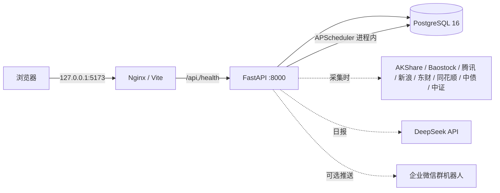

# 01 · 架构总览

## 1. 系统定位

GFNA 不是“预测涨跌的策略系统”，而是一套 **让决策可复现、可归因、可证伪的数据与信号系统**：

- 把行情、估值、资金流、板块、指数、两融、宏观利率、新闻落到本地 PostgreSQL；
- 在本地计算指标、因子、评分、市场状态与板块评分；
- 用条件树选股并落 run 快照；
- 用同一套成交规则做回测、参数敏感性矩阵和纸面组合跟踪；
- 通过 FastAPI + React 展示，并对数据新鲜度做显式标注。

> 代码标题仍写 “V5”，但功能已叠加 V6（呈现/算法中心/纸面）、V7（市场状态/指数对比/牛熊估值）、V8（策略汰换/盘后推送）。阅读时以实际代码与 README 的版本说明为准。

---

## 2. 五层架构

```
┌─ L1 采集 ingest（backend/app/ingest）──────────────────────────────┐
│ Provider 协议 + 降级链：akshare → baostock                         │
│ 专项通道：腾讯 fqkline / 新浪 K 线+资金流 / 东财 datacenter 估值    │
│           同花顺板块 / 中债收益率 / 中证指数 / 巨潮分红             │
│ 横切能力：交易日历、限频、重试、熔断、幂等 upsert、分区、质量校验    │
└───────────────────────────────┬───────────────────────────────────┘
                                ▼
┌─ L2 存储 PostgreSQL 16（backend/app/db）───────────────────────────┐
│ 维度：dim_stock / dim_sector_member(SCD2) / 财报 / 分红            │
│ 事实：fact_stock_daily(按年分区) / fact_feature_daily               │
│       fact_stock_score_daily / fact_moneyflow / fact_sector_daily   │
│       指数 / 两融 / 宏观利率 / 市场因子 / 温度 / 状态 / 日报        │
│ 策略：stg_run / stg_signal / stg_signal_perf                        │
│        backtest_run / backtest_grid / paper_portfolio / paper_nav   │
│ 治理：meta_data_quality / ingest_job / trade_calendar / push_log    │
│ 视图：v_stock_latest / v_stock_features                            │
└───────────────────────────────┬───────────────────────────────────┘
                                ▼
┌─ L3 计算 engine（backend/app/engine）──────────────────────────────┐
│ 指标 → 特征落库 → 六维因子 → 个股评分                               │
│ 市场因子 → 温度计 → 状态机/配置建议                                 │
│ 板块技术/情绪/消息 → 板块评分/龙头 → 板块聚合                       │
│ 信号前瞻收益 → 策略天梯 → 多策略共识                                │
│ 指数多周期收益 → 风格轮动 → 6 宽基牛熊估值                          │
│ 纸面组合净值（复用回测引擎）                                        │
└───────────────────────────────┬───────────────────────────────────┘
                                ▼
┌─ L4 策略 strategy（backend/app/strategy）──────────────────────────┐
│ condition：AND/OR/比较/between/in/top_pct/industry                  │
│ strategies：A3/A4（启用）、C1/C2/C3/C6（候选）；A1/A2/B1–B5/C4/C5 已移除 │
│ runner：参数校验 → 指纹 → 数据版本 → 缓存 → run/signal 落库         │
│ backtest：T+1 开盘、费用/滑点、涨跌停/停牌不可成交、后复权           │
│ grid：rebalance_days × max_positions 敏感性矩阵                     │
│ metrics：收益/年化/回撤/Sharpe/Sortino/Calmar/胜率/换手/超额         │
└───────────────────────────────┬───────────────────────────────────┘
                                ▼
┌─ L5 服务与展示（backend/app/api + frontend）───────────────────────┐
│ FastAPI /api/v1：行情/个股/选股/回测/纸面/元信息/管理/新闻           │
│ 统一错误码 + request_id + 数据新鲜度                                │
│ React：新闻、盘后分析、指数对比、选股中心、纸面、任务监控            │
└────────────────────────────────────────────────────────────────────┘
```

---

## 3. 部署拓扑



关键事实：

- **单进程应用**：FastAPI 与 APScheduler 在同一个进程内；多实例时依赖 PostgreSQL advisory lock 去重；
- **前端只通过相对路径 `/api`**：开发用 Vite proxy，生产用 Nginx 反代，不允许写死后端地址；
- **所有端口只绑 `127.0.0.1`**（Docker compose 同样如此），单机自用；
- **容器启动顺序**：`bootstrap_db.py` → `first_run.py`（空库可选灌演示数据）→ `uvicorn`。

---

## 4. 分层依赖规则

来自 `docs/architecture.md`，并与当前代码一致：

```
api/ ──────────────► strategy/ ──► engine/ ──► db/
 │                        │           │
 │                        └───────────┴──────► core/
 └──► pipeline.py ──► ingest/ ──► db/
```

硬规则：

1. `ingest/` 只依赖 `core` + `db` + pandas/numpy，**不 import `api` / `strategy`**；
2. `engine/` **不联网**（唯一例外：`sector_analysis` 的板块资金流在本地缺失时的降级，受 `INGEST_NETWORK_ENABLED` 控制）；
3. `strategy/` 只读数据库，**不 import `ingest`**；
4. `api/` 不做计算，只做参数校验、读库、组装响应；
5. 定时任务、手动 API、CLI 都走 `pipeline.run_task`，保证“命令行能跑的，接口也能跑”。

---

## 5. 关键请求链路

### 5.1 看盘：`GET /api/v1/market/dashboard`

```
market.py:get_dashboard
  → _latest_trade_date(db)
  → _query_indices / _query_us_indices / _query_sectors
  → _query_margin / _query_report / _count_signals
  → get_freshness_items(db, DASHBOARD_DATASETS)
  → 组装 indices/us_indices/sectors/heatmap_data/top/bottom/margin/report/freshness/stats
```

数据全部来自本地库，不触发外部请求；无数据时返回 200 + `empty_reason`，不抛 500。

### 5.2 选股：`GET /api/v1/algo/{algo_code}`

```
algo.py:get_algo_result
  → _collect_params（按 spec.params_schema 从 query 收集）
  → runner.run_strategy
       → strategies._validate_params（补默认值 + 范围校验）
       → data_version(db, trade_date)
       → params_fingerprint(algo, params)
       → get_cached_run（4 元缓存键）
       → build_candidates（一次横截面 SQL + pandas 过滤）
       → rank_signals（排序/截断/生成 metrics）
       → stg_run + stg_signal 落库
  → 返回 run 元信息 + data[]
```

任何结果都带 `run_id / params / data_version / elapsed_ms / universe_count`，因此可复现。

### 5.3 回测：`POST /api/v1/backtest/{algo_code}`

```
backtest.py:create_backtest
  → 参数校验 + 数据起点裁剪
  → 写 backtest_run(status=queued) 并 commit
  → BackgroundTasks: execute_backtest
       → strategy.backtest.run_backtest
       → 写 success/failed + metrics + equity_curve + trades
  → 立即返回 bt_id / poll 路径
```

前端轮询 `GET /backtest/{bt_id}`；计算在后台独立会话执行，不受 HTTP 30s 超时限制。

### 5.4 每日盘后链路

```
worker.py @15:36 → _with_lock("daily_pipeline")
  → pipeline.run_daily_pipeline(today)
      calendar → universe → index → broad_indices → style_indices
      → sector → sector_members → snapshot → moneyflow → sector_agg
      → margin → valuation → features → scores → sector_scores
      → macro_rates → market_factors → temperature → regime
      → report → algos → signal_perf
```

顺序硬约束：**日线 → 估值 → 指标 → 因子 → 选股**；`market_factors → temperature → regime` 必须按序。

---

## 6. 数据流与口径

### 6.1 个股：从原始行情到信号

```
fact_stock_daily（原始价 + adj_factor + 涨跌停/停牌标志）
   ├─► indicators.compute_features → fact_feature_daily
   │        （MA/RSI/MACD/BOLL/ATR/KDJ/动量/波动/量比）
   ├─► factors（横截面 0–1 分位）→ fact_stock_score_daily（0–10）
   ├─► strategies.build_candidates（LEFT JOIN 上述表 + dim_stock）
   │        → 统一前置过滤 → 策略条件 → rank_signals
   └─► backtest.simulate_portfolio（T+1 开盘、费用、不可成交）
```

### 6.2 市场：从原始因子到状态

```
fact_market_daily（指数趋势/量能/广度/估值/波动，只存原始值）
   ├─► market_temperature（7 子项滚动分位 → 0–100 温度）
   └─► market_regime（750 日滚动分位 → T/M/B/V/Q/R 五组得分 → 五态）
           → 配置建议（防御/进攻/均衡，合计 100%）
```

### 6.3 板块：三面评分

```
fact_sector_daily + 成分 SCD2 + 板块资金流
   → technical_score（趋势 40 / 动量 30 / 量能 30）
   → sentiment（融资 35 / 北向 30 / 资金流 35；新闻独立成第三面）
   → news（当日相关新闻情感）
   → composite = 40% 技术 + 35% 情绪 + 25% 消息
   → leaders（实力龙头 / 情绪龙头）
```

---

## 7. 目录与模块职责

| 目录 | 职责 | 关键入口 |
|---|---|---|
| `backend/app/api/` | HTTP 契约、参数校验、读库组装 | `api/v1/__init__.py` |
| `backend/app/core/` | 配置、常量、错误、日志、状态、所有制 | `core/config.py` |
| `backend/app/db/` | ORM、会话、分区/视图、种子 | `db/models/__init__.py` |
| `backend/app/ingest/` | 数据源与落库 | `ingest/service.py` |
| `backend/app/engine/` | 计算与派生数据落库 | `engine/features.py` 等 |
| `backend/app/strategy/` | 选股、回测、参数矩阵 | `strategy/runner.py` |
| `backend/app/services/` | 新鲜度、LLM、新闻、日报、任务恢复 | `services/freshness.py` |
| `backend/app/notify/` | 企业微信推送 | `notify/push.py` |
| `backend/app/quality/` | 跨表不变量巡检 | `quality/invariants.py` |
| `backend/app/fixtures/` | 离线确定性演示数据 | `fixtures/demo_data.py` |
| `backend/scripts/` | 引导、CLI、回补、运维 | `scripts/pipeline_cli.py` |
| `frontend/src/` | React 页面与图表 | `src/App.tsx` |

---

## 8. 架构约束与非功能特性

| 主题 | 机制 |
|---|---|
| 可复现 | `stg_run` 参数快照 + `data_version` + `params_fingerprint` |
| 防未来函数 | 估值 `announced_date <= T`；回测只读 T 及以前；`assert_no_lookahead()` 扫描负向 `shift` |
| 幂等 | 所有写入 `INSERT ... ON CONFLICT DO UPDATE`；run 重跑标记旧 run `superseded` |
| 并发安全 | `pg_try_advisory_lock`；任务失败不清空旧数据 |
| 可观测 | `ingest_job` 记录 total/done/failed/rows/elapsed；`meta_data_quality` 记录成功率/覆盖率 |
| 失败隔离 | 日更每步独立 try/except；推送失败不影响选股；LLM 不可用降级为模板日报 |
| 限制访问 | 端口只绑本机；管理接口需 `X-Admin-Key` 或本机来源 |

---

## 9. 已知边界与取舍

- **不做多租户**：项目无账号体系，所有页面只服务单机自用；
- **不使用 Celery**：单进程 APScheduler + DB 锁，量大再考虑队列；
- **不接真实交易**：纸面组合只是虚拟跟踪，回测 ≠ 实盘；
- **不保证所有数据源可用**：东财 `push2*` 在部分网络被重置，系统自动降级腾讯/新浪/同花顺/中证；
- **历史深度**：默认近 5 年（`HISTORY_START=2021-01-01`），部分源更短（资金流约 300 日）。
