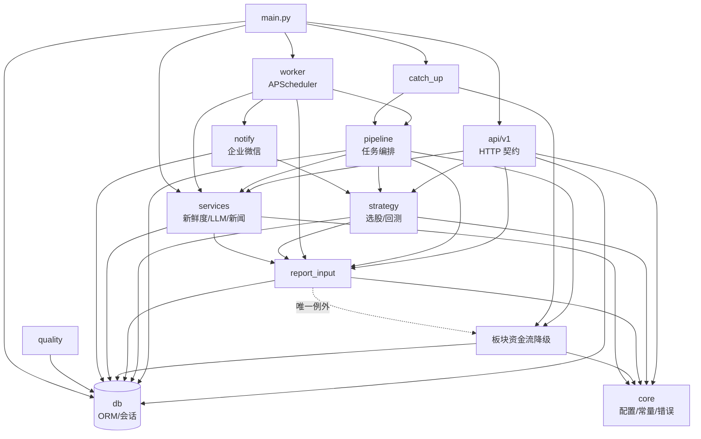

# 09 · 依赖关系、扩展指南与技术债

---

## 1. 后端模块依赖



文字版硬规则：

| 模块 | 允许依赖 | 禁止 |
|---|---|---|
| `ingest/` | `core`、`db`、pandas/numpy | `api`、`strategy` |
| `engine/` | `core`、`db`、`indicators` | 联网（例外：板块资金流降级）、`ingest` 主链 |
| `strategy/` | `core`、`db`、`engine` | `ingest` |
| `api/` | `core`、`db`、`engine`、`strategy`、`services` | 计算逻辑、外部数据源 |
| `services/` | `core`、`db`、`engine.report_input`、LLM/新闻库 | `api` |
| `notify/` | `db`、`strategy`、`core` | `api` |

---

## 2. 前端模块依赖

```
main.tsx
 ├─ QueryClientProvider
 ├─ BrowserRouter
 └─ App.tsx（路由）
      └─ pages/*
           ├─ hooks/*（React Query）
           │    └─ api/*（fetch 封装）
           │         └─ api/client.ts（BASE_URL/错误/重试/CSV）
           ├─ components/*（展示与交互）
           ├─ lib/*（纯函数/本地状态）
           └─ types/*（契约）
```

规则：

- 页面不直接 `fetch`，统一走 `api/`；
- 服务端状态归 React Query，本地 UI 状态归 `useState`；
- 持久化只通过 `lib/algoSession`、`lib/backtestSession`；
- 图表数值由后端计算，前端只做渲染与格式化。

---

## 3. 关键调用链

### 3.1 日更链路

```
worker.run_daily_pipeline_job
  → pipeline.run_daily_pipeline
      → pipeline.run_task(step)
          → ingest.service.*（采集）
          → engine.*（指标/评分/市场/板块）
          → services.report_generator.generate_report
          → strategy.runner.run_strategy
      → quality.invariants.log_invariants
```

### 3.2 看板链路

```
DashboardPage
  → useDashboard → api/market.fetchDashboard
      → api/v1/market.get_dashboard
          → _query_indices / _query_sectors / _query_margin / _query_report
          → services.freshness.get_freshness_items
```

### 3.3 选股链路

```
AlgoCenter
  → useAlgoRun → api/algo.fetchAlgoResult
      → api/v1/algo.get_algo_result
          → strategy.runner.run_strategy
              → strategy.strategies.build_candidates
              → strategy.strategies.rank_signals
              → stg_run / stg_signal
```

### 3.4 回测链路

```
BacktestPanel
  → api/backtest.runBacktest
      → api/v1/backtest.create_backtest
          → BackgroundTasks.execute_backtest
              → strategy.backtest.run_backtest
                  → strategies.build_candidates（每个调仓日）
                  → simulate_portfolio
                  → metrics.compute_metrics
                  → backtest_run
```

### 3.5 纸面链路

```
worker.run_paper_job
  → engine.paper.sync_all_paper_portfolios
      → strategy.backtest.run_backtest(initial_state, phase_anchor, signal_from)
      → paper_nav upsert
```

### 3.6 新闻 → 情绪 → 板块

```
news_collector.collect_news
  → news_articles
      → llm_service.judge_sentiment_batch（可选）
          → sentiment_score
              → engine.sentiment.calc_news_sentiment
                  → sector_analysis composite
```

---

## 4. 跨层共享契约

| 契约 | 位置 | 变更影响 |
|---|---|---|
| 日线字段/单位 | `fact_stock_daily` | 指标、策略、回测、前端 |
| 新鲜度 dataset 名 | `pipeline.TASK_DATASET` + `freshness.DATASET_META` | 前端徽标、`/health` |
| 错误码 | `core/errors.py` | 前端提示、测试 |
| run 响应结构 | `docs/V5-API-CONTRACT.md` 5.2 | 选股中心 |
| 回测 metrics 键 | `strategy/metrics.METRIC_KEYS` | 回测面板、矩阵 |
| 信号 metrics | `strategies._METRIC_FIELDS` | 结果表动态列 |
| 策略参数 schema | `StrategySpec.params_schema` | 前端表单、API 参数收集 |
| 指数代码 | `core/constants.INDEX_MAP` / `STYLE_INDEX_MAP` / `BROAD_INDEX_MAP` | 采集、看板、回测基准 |
| 事务所有权 | `db=None` vs 传入 `db` | 所有引擎/策略/采集函数 |

> 修改上述任一契约，必须同步更新后端、前端 `types/`、测试和本 Wiki。

---

## 5. 扩展指南

### 5.1 新增技术指标

1. `engine/indicators.py` 实现纯函数；
2. 在 `compute_features` 中计算并加入 `FEATURE_COLUMNS`；
3. 在 `db/models/fact.py:FactFeatureDaily` 增加列 + Alembic 迁移；
4. `engine/features.py` 自动按列写库（无需额外逻辑）；
5. 若策略需要，在 `strategies._METRIC_FIELDS` 与条件构造中引用；
6. 前端 `types/stock.ts` 与个股详情指标卡增加展示；
7. 补 `tests/test_indicators.py` 已知序列断言。

### 5.2 新增因子

1. `engine/factors.py` 实现返回 0–1 分位的函数；
2. 在 `stock_score.compute_factor_percentiles` 注册；
3. 调整 `FACTOR_WEIGHTS`（总和建议为 1）；
4. `detail` JSONB 会自动保留原始值与分位；
5. 策略可通过字段名直接使用；
6. 前端雷达图/评分榜如需展示，更新 `types` 与组件。

### 5.3 新增数据源

1. 继承 `ingest.base.BaseProvider`，实现所需 `fetch_*`，返回 `FetchResult`；
2. 在 `service._PROVIDER_REGISTRY` 注册，或专项函数直接调用；
3. 统一单位/列名；
4. 在 `quality.py` 增加校验；
5. 在 `pipeline.TASK_DATASET` 登记 dataset；
6. 补离线测试（fixture，不联网）。

### 5.4 新增策略

见 [06-策略与回测 §10](./06-strategy-backtest.md#10-新增策略的步骤)。

### 5.5 新增 API

见 [02-后端应用层 §8](./02-backend-api.md#8-扩展一个-api-的步骤)。

### 5.6 新增页面

见 [07-前端应用 §12](./07-frontend.md#12-扩展一个页面)。

### 5.7 新增定时任务

1. 在 `worker.py` 写 `run_*_job(db)`；
2. `start_scheduler` 注册 `CronTrigger` + `_with_lock`；
3. 任务体必须幂等、支持非交易日短路；
4. 在 README / 本 Wiki 的定时任务表补一行；
5. 若耗时长，考虑 `misfire_grace_time` 与 catch-up 补跑。

---

## 6. 技术债与风险清单

> 以下为代码阅读中可直接观察到的事实，不代表必须立即修改；用于排期与风险评估。

| 项 | 事实 | 影响 / 建议 |
|---|---|---|
| 超大模块 | `ingest/service.py` 139KB（唯一 >72KB 模块）；`engine/market_regime.py` 50KB | V9 已完成：`strategy/strategies.py` → `specs/data/market/conditions/ranking/candidates`；`ingest/valuation.py` → `valuation_math` + `valuation_store` + 门面；`ingest/akshare_provider.py` → `akshare_normalize` + provider。`service.py` 下一批按 job/collector 拆分；体积守卫见 `tests/test_module_size_budget.py` |
| 指标重复实现 | `engine/market_factors.py` 内部重新实现 `ema/rsi/atr/adx`，未复用 `engine/indicators.py` | 口径漂移风险；新指标应优先复用 indicators |
| 估值双路径 | `valuation_fast`（东财）与 `valuation`（本地财报推算）并存 | 两套口径可能不一致；需在 freshness/detail 中标注来源 |
| 硬编码快照 | `BROAD_INDEX_SNAPSHOT`、`BROAD_ERP_SNAPSHOT` 固定为 2026-11-13 | 时间推移后 PE/ERP 会过期；需定期更新或改为动态计算 |
| 废弃策略实现 | A1/A2/B1–B5 的策略代码已于 V9 清理删除；历史 run 数据仍在库中 | 需要复现旧策略时从 git 历史恢复并重新验证 |
| 双事实源 | `algo_meta` 表 vs `strategy.SPECS` | 以 `SPECS` 为准；`algo_meta` 仅种子/台账 |
| 文档过时 | `docs/architecture.md` 仍写 V5（21 表、A1–A4） | 以本 Wiki 与 README 为准 |
| 空 `sql/` 目录 | 实际 DDL 在 ORM + `db/views.py` + Alembic | 不要在本目录寻找建表脚本 |
| 密钥风险 | `.env` 可能含数据库密码/DeepSeek Key/Webhook | 确保被 `.gitignore` 忽略；泄露即轮换 |
| 大文件/构建产物 | `.venv`、`site-packages`、`frontend/node_modules`、`dist*` 在工作区 | 不属于源码；提交前检查 `.gitignore` |
| 根 `tests/` | 已于 2026-11-21 清理删除（V2 遗留、与 `backend/tests/` 重复且失修） | 测试统一放 `backend/tests/` |

---

## 7. 术语表

| 术语 | 含义 |
|---|---|
| **A3** | 央企 × 综合评分策略 |
| **A4** | 高股息质量 × 低估值策略（带防御阶段门槛） |
| **C1/C2/C3/C6** | 2026-11-28 起为正式启用策略；进入每日任务、共识、天梯、纸面组合与回测 |
| **C4、C5** | 已移除策略（涨停洗盘 / 均线放量突破）；实现、测试与参数已删除，仅历史 run 可查 |
| **B1–B5** | 已移除的短线策略；实现已删除，仅历史 run 可查 |
| **run_id** | 一次策略运行的 UUID，信号与参数快照的关联键 |
| **data_version** | 当日四表行数 + 最近写入时间哈希；缓存失效依据 |
| **参数指纹** | 归一化参数的稳定哈希；与 data_version 共同构成缓存键 |
| **SCD2** | 缓慢变化维：用 `effective_from/effective_to` 表达成分区间 |
| **point-in-time** | 只用当时可知的数据（财报按公告日、分红按除权日） |
| **后复权** | `close × adj_factor`，包含分红送转收益 |
| **升/贴水** | 本系统未涉及股指期货；ERP/股债差用于估值参考 |
| **ERP** | 盈利收益率 − 10Y 国债收益率 |
| **RPS** | 相对价格强度（横截面百分位） |
| **温度** | 7 子项加权的 0–100 市场热度分 |
| **五态** | trend_up / repair_up / bottoming / pull_down / risk_off |
| **天梯** | 策略信号级 5/10/20 日前瞻收益与胜率排行 |
| **共识** | 同一股票被多个策略同时命中的榜单 |
| **纸面组合** | 按策略信号虚拟跟踪的组合，不涉及真实交易 |
| **新鲜度** | `meta_data_quality` 表达的“这个数据集现在可信吗” |
| **universe** | 当日有行情的全市场标的数（run 元信息字段） |
| **fillable** | T+1 是否可真实成交（非停牌/非一字板） |
| **mature_H** | 第 H 个交易日窗口是否已走完 |

---

## 8. 相关文档

- [01-架构总览](./01-architecture.md)
- [02-后端应用层](./02-backend-api.md)
- [03-数据模型](./03-data-model.md)
- [04-采集与数据质量](./04-ingest.md)
- [05-计算引擎](./05-engine.md)
- [06-策略与回测](./06-strategy-backtest.md)
- [07-前端应用](./07-frontend.md)
- [08-运行与部署](./08-operations.md)
- 仓库根 `README.md`、`docs/V5-API-CONTRACT.md`、`docs/architecture.md`、`docs/evidence/`

---

## 9. 3 分钟体验路径（只读演示）

不装 PostgreSQL / Docker，只用 Node：

```bash
cd frontend
npm install
npm run build:demo
npm run preview
```

打开终端提示的地址即可浏览盘后分析、选股中心、新闻情报、个股详情、关于页。
数据来自 `backend/scripts/export_demo_snapshot.py` 生成的 `frontend/public/demo/`，顶部有只读横幅；完整采集、选股写入、回测仍需 PostgreSQL。发布与更新说明见 [08-operations.md](./08-operations.md#13-演示站发布与更新)。
